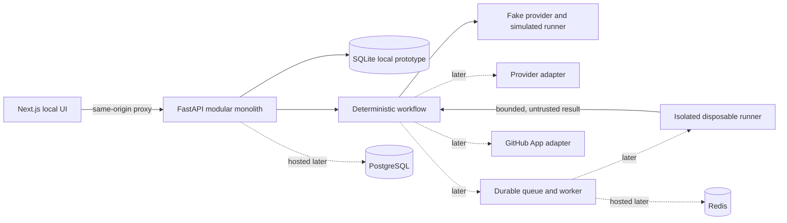

# BugPilot AI — Architecture Proposal

**Status:** Revised proposal; implementation requires explicit approval

**Date:** 2026-11-05

> The repository currently contains planning and Copilot configuration only. This document proposes a local Python/pytest prototype and a later SaaS architecture; it does not describe implemented code or verified security controls.

## 1. Product and staged scope

BugPilot turns a developer's bug report into a reviewable, evidence-backed investigation: inspect relevant Python source, formulate hypotheses, propose a reproduction test, execute in isolation, inspect results, propose a patch, and verify it. A human owns decisions to publish changes.

### Stage A — local prototype

Validate the end-to-end investigation experience at low cost. A single developer runs the web UI and API locally, chooses a curated fixture repository, submits a report, follows a deterministic investigation, and reviews hypotheses, evidence, test/patch proposals and verification states.

- Use local fixture repositories, deterministic fake LLM/provider output and a fake execution adapter initially.
- Include a minimal Next.js UI in the first backend vertical slice.
- Use a local SQLite database and owner-private filesystem artifacts; no hosted Postgres, Redis, object storage, multi-tenant workspaces or billing.
- No GitHub App, issue import, login system, PR creation, live provider, or execution of arbitrary repository code in this stage.
- Fake-provider output must be labeled fixture/fake output; simulated runner results must be labeled simulated. Neither is actual model generation or test execution.

### Later stages

- **Stage B — read-only Python analysis:** inspect explicitly provided safe snapshots; bounded AST/symbol/traceback context, without executing repository code.
- **Stage C — isolated pytest pilot:** actual baseline/reproduction and patch tests only through a separately disposable execution boundary after independent security review and evidence of every gate in `SECURITY.md`.
- **Stage D — hosted single-tenant pilot:** selected identity, approved provider/data policy, durable hosted state/queue/artifacts, and controlled repositories; GitHub read access only if required.
- **Stage E — multi-tenant SaaS:** workspaces, robust identity/roles, tenant isolation, quotas, retention/deletion, operations and support.
- **Stage F — GitHub writes and product expansion:** explicit PR approval, billing and additional language adapters at separate milestones.

Out of the local prototype: GitHub App/webhooks/issues; auth/workspaces/billing; hosted services; real provider calls; arbitrary target dependency install or code execution; PR/branch writes; automatic merge; embeddings; microservices; Kubernetes; WebSockets.

## 2. System architecture and module boundaries

Keep application/domain logic in a **modular monolith**. Add separate processes or services only at explicit trust/scaling boundaries: API/UI, trusted workflow worker as needed, and an isolated untrusted-code runner. The local prototype replaces external adapters with deterministic fixtures without changing the domain workflow.

In the hosted target, PostgreSQL is the source of truth; an outbox publishes at-least-once jobs to a queue such as Redis; idempotent workers run a fixed workflow; the runner receives only a pinned snapshot and constrained test request. The runner has no control-plane credentials. Do not introduce the hosted topology locally for symmetry.

| Module | Owns | Prototype implementation |
|---|---|---|
| `api` | HTTP routes, request/response contracts, errors, local API boundary | FastAPI routes for investigation lifecycle |
| `investigations` | Report, state transitions, queries and user-visible lifecycle | Single-user investigation records; owns transition rules |
| `repository_context` | Snapshot interface, Python detection, bounded relevant context and provenance | Fixture manifest/catalog only; no arbitrary path access |
| `orchestration` | Versioned finite workflow, budgets, step outcomes and adapter protocols | Deterministic fake provider/execution adapters; drives transitions via `investigations` |
| `evidence` | Provenance vocabulary and evidence construction/validation | Generated/simulated fixtures; timeline append/sequence is owned by `investigations` in same transaction as state |
| `persistence` | Query interfaces and transaction boundaries | SQLite adapter |
| `providers` | Replaceable model interface and normalized failures | Fake deterministic provider only; producer identity explicit |
| `execution` | Runner request/result protocol and verification rules | Simulated result only; actual execution disabled |
| `web` | Investigation creation, progress/evidence/result UI | Minimal Next.js UI consuming API responses |
| `github`, `tenancy`, `jobs` | GitHub, multi-user access, durable hosted jobs | Deferred until later stages |

Keep HTTP DTOs, domain types and persistence models distinct where useful. Domain logic calls protocols/adapters, not provider SDKs or runner implementation details. Python analysis and pytest are language capabilities behind a future adapter boundary; do not generalize before a second language is needed.

### First-slice local flow

1. User chooses a curated fixture ID and submits a report through the UI.
2. API validates input, creates a local investigation and initial event transactionally, and responds `202` after it is durably `queued`.
3. A bounded in-process coordinator queue runs the fake workflow; this is intentionally not a durable hosted job queue.
4. Workflow records fixture source context and fake-provider hypotheses/test/patch proposals with `content_type=generated`, `producer_kind=fake_provider`, producer version and source fixture ID.
5. Simulated runner records `producer_kind=simulated_runner`, `execution_status=simulated`; `verification_outcome=not_run`.
6. UI polls persisted API state and displays fixture/fake output, simulated execution and the fact that no test ran.
7. On process restart, any nonterminal queued/running investigation is marked `interrupted` with an event; it is not silently resumed.

The local UI and API use a same-origin Next.js proxy/rewrite to FastAPI. Both bind only to `127.0.0.1` and `::1`. Configure exact UI origin and API loopback host/port at startup. The proxy strips client-supplied forwarding headers; the API does not trust `X-Forwarded-*`, accepts only its configured Host, requires exact non-null `Origin` plus `Sec-Fetch-Site: same-origin` on mutations, and exposes a same-origin CSRF-token endpoint. The browser keeps the token in memory and sends it in `X-CSRF-Token`; the API compares it in constant time. Do not enable permissive CORS. Test the actual proxied request path.

### Hosted target flow

Authorized user pins a repository commit → durable investigation/outbox → trusted worker retrieves bounded context without executing code → provider returns validated proposals → isolated runner executes baseline reproduction → provider proposes patch → isolated runner checks patched focused test and suite → evidence and outcomes persist → UI presents review → later explicit user approval may trigger GitHub PR.

## 3. Lifecycle, events and API contract

### Investigation state

Stage 1 status enum: `queued`, `analyzing`, `reviewable`, `failed`, `cancelled`, `interrupted`.

- `reviewable` is the successful terminal workflow status for this run; it means generated/simulated material is ready to inspect, not that tests passed or a patch is verified.
- `failed`, `cancelled`, and `interrupted` are terminal for a particular investigation. Stage 1 has no retry endpoint; the user starts a new investigation with a new idempotency key.
- Allowed Stage 1 transitions: `queued -> analyzing|cancelled|interrupted`; `analyzing -> reviewable|failed|cancelled|interrupted`. Invalid transitions return `409`.
- Coordinator requests a transition through the `investigations` use case; that module owns status, monotonically increasing per-investigation event sequence, and atomic state+event transaction.
- `POST` returns `202` only after initial record/event are committed in `queued`. Background coordinator may finish before the client polls; `GET` always returns authoritative current state. On startup, recover nonterminal rows to `interrupted` and append events.
- Cancellation is available in Stage 1. First cancel of nonterminal work returns `202` and transitions to `cancelled`; repeat cancel on already-cancelled work returns current state idempotently; other terminal states return `409`.
- State transitions use compare-and-set/optimistic versioning in one transaction. If cancellation commits first, it sets a durable cancellation flag; the coordinator checks it before each stage and before writing results, and cannot append workflow output or advance state afterward. If completion commits first, cancellation returns `409` with current terminal state. A late worker result is discarded and logged as a bounded internal cancellation race, not appended as investigation evidence.
- Idempotency key reservation, normalized request hash and investigation creation are atomic under a unique key constraint. Concurrent same-key/same-body requests resolve to one investigation and return its ID; same key/different body returns `409`.

The UI polls detail/events after a cursor, starting at 1 second and backing off to at most 5 seconds while active. It stops on terminal status, aborts stale requests, deduplicates by event sequence, and retains last-known data with a visible stale/error marker on transport failure. It does not map network failure to investigation failure.

### Event and evidence fields

Each event has `sequence`, `type`, `created_at`, and bounded data. Stage 1 event types are `investigation_queued`, `analysis_started`, `evidence_added`, `investigation_reviewable`, `investigation_failed`, `investigation_cancelled`, and `investigation_interrupted`; data contains only safe status/message codes and evidence IDs, not unbounded source or logs. Evidence DTO fields are `id`, `kind` (`source_reference`, `hypothesis`, `test_proposal`, `patch_proposal`, `execution_result`), `content_type` (`generated`, `observed`, `simulated`), `producer_kind` (`fixture`, `fake_provider`, later `llm_provider`, `simulated_runner`, later `runner_supervisor`), `producer_version`, optional `source_fixture_id`, and optional source revision/path/line/hash or artifact reference. `producer_kind` identifies the producing component; `source_fixture_id` identifies fixture-authored input. Fixture-authored proposals are not described as live LLM output. Simulated output is never described as observed execution.

`GET .../events?after=N` returns events whose sequence is **strictly greater than** `N`, in ascending order, with a nullable next cursor. Repeated pages are safe; clients deduplicate by sequence.

### Stage 1 API

All local endpoints use `/api/v1`. The browser reaches them through the same-origin UI proxy. No route accepts arbitrary local paths.

| Method | Path | Contract |
|---|---|---|
| `GET` | `/api/v1/csrf` | `{token}` per local app process; fetched through same-origin proxy only; token is required for mutations |
| `GET` | `/api/v1/fixtures` | `{items:[{id,title,language,revision}]}` for curated manifest entries only |
| `POST` | `/api/v1/investigations` | Body `{fixture_id,report}` (UTF-8 report limit 16 KiB, total JSON body limit 32 KiB); requires `Idempotency-Key` and `X-CSRF-Token`; commit then return `202` `{id,status:"queued",verification_outcome:"not_run",execution_status:"not_requested",provider_mode:"fake"}` |
| `GET` | `/api/v1/investigations/{id}` | `{id,status,verification_outcome,execution_status,fixture:{id,title,revision},created_at,updated_at,latest_event_sequence,evidence:[EvidenceItem]}`; no Stage 1 run entity |
| `GET` | `/api/v1/investigations/{id}/events?after={sequence}` | `{items:[{sequence,type,created_at,data}...],next_cursor}` with exclusive cursor semantics |
| `POST` | `/api/v1/investigations/{id}/cancel` | Requires CSRF token. If cancellation wins CAS: `202` and `cancelled`; repeated cancel returns current cancelled record; if other terminal transition wins, `409` with current status |
| `GET` | `/api/v1/health` | Minimal local liveness; no environment details |

`EvidenceItem` is `{id,kind,content_type,producer_kind,producer_version,source_fixture_id?,title,summary,source_ref?}`; `source_ref` contains only repository-relative `path`, `line_start`, `line_end`, `revision`, and `content_hash`. `execution_status` and `verification_outcome` are separate enums. Stage 1 `execution_status` may be `not_requested` or `simulated`; `verification_outcome` is always `not_run`. `simulated` is never a verification outcome. In later stages, `execution_status` describes an attempt (`queued`, `running`, `completed`, `setup_failure`, `timeout`, `cancelled`, `lost`); verification outcome describes policy classification.

The idempotency key is scoped to the local app and reserved atomically with investigation creation under a unique constraint. Same key + same normalized request returns the original investigation; same key + different request returns `409`. Use a stable JSON error body `{code,message,request_id}`; safe codes include `invalid_request`, `unknown_fixture`, `not_found`, `invalid_state`, `idempotency_conflict`, and `internal_error`. Do not expose stack traces, filesystem paths, secrets or report contents in errors.

No GitHub, login, workspace, provider, approval, PR or real execution endpoint is exposed in Stage 1.

## 4. Verification semantics (future execution stage)

Actual verification consists of three distinct observed phases pinned to the same source commit and immutable runtime/dependency profile:

1. **Baseline reproduction:** run a focused regression test against unmodified source. `reproduced` only when the target test executes and reports the expected assertion failure. A generic nonzero exit, collection error, crash or setup failure is not reproduction. If it completes and passes or expected behavior is absent, outcome is `not_reproduced`; stop patch verification.
2. **Patched focused regression test:** only after baseline reproduction, apply patch to a fresh workspace and run the same focused test identity and content digest. Expected completed pass is `passed`; test failure is `patch_not_verified`; patch application failure is `patch_apply_failed`.
3. **Existing-suite regression comparison:** run a baseline suite inventory and the same selected test IDs against baseline and patched snapshots under the same runtime/dependency/config profile. Bind both runs to suite-selection and inventory digests. A missing baseline test/new failure is `regression_detected`; changed inventory/selection, incomplete collection or non-comparable result is `inconclusive`. Baseline failures are preserved and disclosed, not hidden.

| Outcome | Meaning |
|---|---|
| `not_run` | No actual execution occurred (including Stage 1). |
| `reproduced` | Baseline focused test completed and reported its expected failure under the named policy; patch testing may proceed. |
| `not_reproduced` | Focused test completed on baseline but the expected bug behavior did not occur. |
| `setup_failure` | Environment/dependency/configuration/collection setup did not permit a meaningful test result. |
| `timeout` | External supervisor observed deadline expiry; never a pass. |
| `inconclusive` | Worker/result lost, incomplete/ambiguous report, non-comparable runs, or flaky/non-repeatable outcome. |
| `patch_apply_failed` | Candidate patch did not apply to the pinned base. |
| `passed` | Patched focused regression test completed successfully; existing-suite comparison is still required before `verified_patch`. |
| `patch_not_verified` | Baseline reproduction was established but patched focused test did not pass. |
| `regression_detected` | Existing suite has new or materially worsened patched failures. |
| `verified_patch` | Baseline reproduction established; identical focused test (identity and content hash) passes on patched tree; baseline/patched suite runs complete under equivalent policy with identical suite-selection profile and test-inventory digest; no new/worsened suite failures; source, patch, runtime and supervisor provenance intact. |

For baseline classification, require the supervisor-observed process result plus a bounded pytest report containing the expected focused test ID and expected assertion failure. A passing test, missing test ID, collection/setup error, crash, report/exit disagreement, or unrecognized failure becomes `not_reproduced`, `setup_failure`, or `inconclusive` according to the observed reason; never infer the expected assertion from free-form logs or LLM interpretation. The pytest report is still untrusted and can be manipulated by hostile test code, so this is evidence under a constrained test policy, not proof of semantic correctness.

The supervisor runs the same focused test identity/content digest against the patched tree. For existing-suite comparison, persist the baseline test-inventory digest and selection profile; execute that same inventory on both trees under identical runtime/dependency/config profiles. A missing baseline test or new failure is `regression_detected`; changed inventory/selection, incomplete collection, non-comparable environment or non-repeatable result is `inconclusive`. Added tests are reported separately and do not silently change the comparison set. Repeat counts and flake thresholds must be approved before execution is enabled.

The trusted supervisor outside the test process creates the attestation; repository code cannot read its signing material or write to its control channel. Bind attempt ID, source/patch/focused-test hashes, suite inventory digest, immutable runtime/dependency profile, command profile, process exit/signal, time/resource limits and bounded artifact digests. Reject replayed attempts. Test reports/stdout remain untrusted and may be manipulated by repository code. If trusted harness data cannot establish a classification, return `inconclusive`. `verified_patch` means the patch passed this named test policy; it is not proof of correctness or test-suite quality. The LLM may summarize these facts but cannot set or override an outcome.

Before enabling live provider calls or execution, centrally approve and enforce per-investigation and aggregate caps for calls/retries, token or spend budget, context bytes, wall time, runner resources, output/artifact size and concurrency. The coordinator stops before scheduling another step when a cap is reached and records terminal workflow status `budget_exhausted`; this is not a verification outcome and cannot imply success. No fallback can bypass the limit. Numeric caps are intentionally unresolved until workload and provider/runtime profiles are selected.

## 5. Data model evolution

Stage 1 SQLite tables: `investigations`, `investigation_events` (unique sequence per investigation), `evidence_items`, `idempotency_records`, plus curated fixture metadata that may remain manifest-only. SQLite and the local schema are prototype persistence, not customer data migration. Hosted transition uses explicit migrations and PostgreSQL integration tests; do not assume repository abstractions alone guarantee portability.

Hosted SaaS can add users, workspaces, memberships, installations, repositories, runs/attempts, artifacts, sandbox executions, approvals, GitHub operations, outbox records and tenant-scoped constraints. PostgreSQL becomes source of truth, queue delivery is at-least-once and idempotent, large artifacts move to private object storage. Do not hold DB transactions open across providers/GitHub/runner.

## 6. Dependency, pytest and execution policy

### Prototype

BugPilot's own dependencies are installed by a developer from a reviewed pinned lockfile. No target-project dependency installation or target pytest execution occurs. Fixtures use controlled dependencies only. Fake provider and simulated runner are the defaults.

### Future execution pilot

- Support reviewed, pinned dependency profiles only. Prefer approved binary wheels from trusted sources, with hash verification plus provenance/review, vulnerability review, SBOM/attestation where available, and update/revocation ownership.
- Build any approved wheelhouse in a separate disposable, unprivileged builder with no production credentials and restricted network. Reject source distributions by default; if source build is exceptionally required, isolate it as hostile code and independently review resulting artifacts before promotion. Hashes prove artifact identity, not benign behavior.
- Runner has deny-by-default egress. It consumes an immutable approved wheelhouse/runtime and never runs `pip install` against repository manifests or package indexes. Missing dependencies are `setup_failure`, no network fallback.
- Set `PYTEST_DISABLE_PLUGIN_AUTOLOAD=1`; use runner-owned pytest config and fixed argument construction, never repository-provided options or config as command authority. Reject unauthorized `-p` options; statically inspect `pytest_plugins` declarations and allow only literal, explicitly approved plugin IDs. Reject dynamic/indirect or uninspectable registrations rather than guessing. This reduces implicit plugin loading but is not a sandbox: repository `conftest.py`, config and tests remain arbitrary executable code inside the isolated runner.
- The supervisor creates per-attempt attestations outside the test process using supervisor-derived input hashes and OS process/limit outcomes; test code cannot access its signing material or result channel, and attempt IDs are single-use. Pytest reports/output remain untrusted and do not independently prove test correctness.

## 7. GitHub, hosted jobs and deployment (later)

GitHub App read access and issue intake are staged after the local prototype. Validate webhook HMAC on raw body, delivery deduplication, installation/repository ownership and least-privilege scope. PR write requires explicit user approval bound to exact patch hash and base SHA, fresh access/base check, no force push and auditable conflict handling. Tokens/private keys remain in trusted control plane, never model/runner/queue.

Hosted deployment may use Next.js frontend, FastAPI API, PostgreSQL, transactional outbox, Redis queue, workflow workers, private object storage, secret manager, monitoring and separate runner fleet. Use one region initially; add HA/multi-region only for measured SLO needs. Local prototype needs none of these hosted services.

## 8. Testing, risks and open decisions

First-slice tests cover schema and input limits, fixture-manifest containment/traversal/symlink/special-file rejection, idempotency, exclusive cursor/order, state transitions/restart interruption/cancel semantics, fixture provenance, simulated-not-run behavior and invariant that simulated output cannot become verified. UI tests cover real API loading/submission, polling/backoff/terminal stop, stale/network failure, duplicate events, cancellation, not-found, accessibility and no fabricated states.

Later verification tests cover baseline reproduced/not reproduced, setup failure, target test failure, patch apply failure, patched pass, existing baseline failures, new regression, timeout, cancellation, flaky/inconclusive, worker loss, forged reports, test-hash mismatch and exact evidence binding. Security tests cover host/origin/CSRF, pytest plugin config controls, dependency profile, network denial, resource limits, process termination and cleanup.

Principal risks are hostile code and package hooks, prompt injection, model false claims, result/report tampering, local sensitive-data exposure, tenant leakage, provider data handling and runaway costs. Security gates and unresolved product decisions are recorded in `ARCHITECTURE_DECISIONS.md` and `SECURITY.md`.
