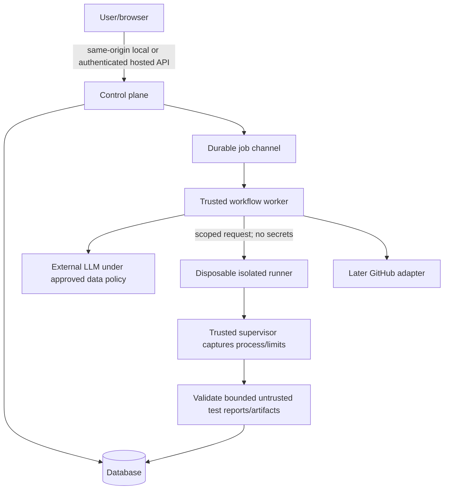

# BugPilot AI — Security Architecture and Threat Model

**Status:** Proposed controls; no application or runtime security has been implemented or verified

**Date:** 2026-11-05

## 1. Threat model

Protect source, issue data, generated patches, user/session data, GitHub credentials, application/database/cloud infrastructure, evidence integrity and availability. Treat reports, repository files, branch names, manifests, tests, `conftest.py`, pytest plugins, package hooks, model output, logs, artifacts and webhooks as hostile.

Threat goals include prompt injection/data disclosure, arbitrary code execution, worker escape, network pivot/SSRF, tenant leakage, unauthorized GitHub writes, false verification, artifact traversal, supply-chain compromise and resource exhaustion.

## 2. Local prototype security

Stage 1 is fixture-only: server-owned fixture manifest, deterministic fake provider and simulated runner. The application must not contact external services at runtime. Developer setup may download BugPilot's own dependencies from an approved package source using a reviewed lockfile; this does not permit target repository dependency downloads. No target test code is executed, no target pytest suite is run, no external LLM API or GitHub is contacted, and no such credentials are needed. No user-supplied path is opened. Fixture IDs map through a fixed manifest to files under a canonical fixture root; reject traversal, symlinks/reparse points, special files, unknown entries and out-of-root resolution. Use race-resistant no-follow/handle-relative file opening rooted at the trusted directory; canonicalize-and-check followed by an ordinary open is insufficient against replacement races. User input is never used as a path.

Bind API and UI to `127.0.0.1` and `::1` only. Browser calls go through a same-origin Next.js proxy. The proxy strips inbound forwarding headers and targets only configured API loopback authority; API trusts no `X-Forwarded-*` and checks its configured backend `Host`. On mutations, require exact configured non-null `Origin`, `Sec-Fetch-Site: same-origin`, and `X-CSRF-Token`. A same-origin `GET /api/v1/csrf` returns a random per-process token; browser holds it in memory and sends the header; API compares in constant time. Do not enable permissive CORS. Test the actual proxied flow, missing/null/hostile Origin, forged forwarding headers, CSRF failures, DNS-rebinding-style Host mismatch and non-loopback bind attempts. Browser controls are not full authentication; the prototype is for a trusted local developer only.

Use these prototype data paths: Windows `%LOCALAPPDATA%\\BugPilotAI\\prototype`; macOS `~/Library/Application Support/BugPilotAI/prototype`; Linux `${XDG_DATA_HOME:-~/.local/share}/bugpilot-ai/prototype`. On Windows disable inherited broad ACLs and grant current user plus required system account only; on macOS/Linux create owner-only directories (mode `0700`) and files (mode `0600`). Verify effective ACLs/modes at startup; fail closed for non-synthetic or sensitive data if owner-only access cannot be established. Keep data outside repository, webroot, OneDrive/other synced/shared folders; bound storage and document deletion. Do not log full reports, source or secrets. Render fixture/model text inertly.

Manually running a developer's own trusted code is not a BugPilot sandbox result and must not be presented as isolated or verified.

## 3. Dependency and pytest controls

- Install only BugPilot dependencies from reviewed, pinned project lockfiles in developer setup.
- Target dependency installation and target pytest execution are disabled in Stage 1.
- For future runner, approved binary wheels require a named trusted-source policy, provenance/review, hashes, vulnerability review, SBOM/attestation where available, promotion approval and revocation path; hashes alone do not prove benign content. Build artifacts in a disposable unprivileged builder with no production credentials and explicit egress restrictions. Reject source distributions by default; exceptional builds require isolated treatment/review. Exact source allowlist, builder network rules, provenance format and promotion owner remain unresolved gates.
- Runner uses immutable curated wheelhouse/runtime, no live package-index access or target requirements install. Missing dependency is `setup_failure`, fail closed.
- Set `PYTEST_DISABLE_PLUGIN_AUTOLOAD=1`; use runner-owned pytest configuration and fixed argument builder. Ignore repository pytest config for plugin/command options; reject unauthorized `-p`; permit only literal statically verifiable `pytest_plugins` declarations naming approved runtime plugin IDs. Reject dynamic, indirect or uninspectable registration. Constrain imports to approved runtime. Tests, `conftest.py` and package code still execute arbitrary code and remain hostile; static plugin checks do not make them safe outside the isolated runner.

## 4. Hosted trust boundaries

Hosted mode authenticates identity separately from GitHub installation authorization. Enforce workspace/resource access server-side on every API, event, artifact, cancel and write. Minimize model data; obtain decisions on disclosure, retention, region, provider training/use and deletion before real source is sent. GitHub private keys and short-lived installation tokens stay in trusted control plane, never prompts, queue payloads or runners.

Webhook stage validates HMAC over raw body before parsing, caps body size, validates event/action and installation/repository, deduplicates delivery ID, then durably enqueues. GitHub writes require fresh authorization and explicit approval bound to exact patch hash/base SHA.

## 5. Execution launch gate (default off)

Actual repository test execution remains disabled until a server-side fail-closed gate has no bypassing API/worker path and independent reviewers verify an evidence matrix for each item:

1. Separate disposable execution plane; hardened container or per-job VM/microVM selected by threat assessment. Ordinary Docker/shared daemon is not presumed sufficient.
2. Non-root, pinned image digest, no privileged mode/host socket/host PID/network namespace/devices/sensitive mounts/untrusted Dockerfile build on privileged host.
3. Read-only base where feasible, ephemeral workspace only, archive/path/symlink/special-file bounds, cleanup on all paths.
4. No credentials; explicit allowlisted environment and mounts, not inherited developer/control-plane environment. Test process cannot read supervisor signing material or write the supervisor control channel. Supervisor derives input hashes and produces the attestation outside the process; use one-time attempt IDs and reject replay.
5. Enforced deny egress outside the test process across IPv4/IPv6, DNS, UDP, loopback/host services, metadata, internal ranges and host-gateway routes. Test attempted access/exfiltration; a container network flag alone is insufficient.
6. Hard CPU/memory/process/disk/time/output/concurrency limits; external supervisor kills process tree, records resource status and verifies cleanup.
7. Approved dependency provenance/wheelhouse; network-off execution; plugin autoload/config controls above.
8. Result provenance binds attempt, source/patch/focused-test hashes, runtime/dependency and command profiles, timestamps, supervisor identity, OS process outcomes and artifact digests.
9. Adversarial tests for environment leakage, network, metadata, filesystem/archive/symlink escape, plugin/config loading, resource exhaustion, timeout/cancel, forged/lost reports, replay and cleanup. Document evidence and residual risk.

Pytest reports, stdout, logs and artifacts are untrusted even when received over an authenticated channel: tested code may manipulate test reports. A trusted supervisor outside the process records OS exit/signal, resource/time outcomes and hashes. `verified_patch` means success under a named test policy, not proof of patch correctness or test-suite quality. If evidence is missing or ambiguous, fail closed as `inconclusive`. Missing/stale gate evidence disables execution. Numeric provider/runner budgets and repeat/flakiness policy must also be approved and enforced before live calls or execution.

## 6. GitHub, artifacts and operations (later)

Start GitHub with minimum metadata/contents read; add Issues read only if needed. PR write comes later after explicit approval and race-safe checks; no auto-merge. Do not fetch arbitrary URLs from reports/model/repo files; use authorized GitHub APIs and SSRF controls.

Artifacts are private, bounded, access-checked and retention-controlled. Validate type/path/size; escape on display; remove according to deletion policy across DB, storage and backups. Add quotas for request, repository bytes, provider calls/tokens/cost, runner resources, concurrency and output. Use outbox/idempotent workers when hosted. Provide audit, alerts, incident response and kill switches.

## 7. Stage validation

1. **Stage 1, local end-to-end vertical slice:** fixture containment, loopback/Host/Origin/CSRF tests, local data protection, queue admission, and no external-service contact or target execution.
2. **Stage 2, read-only Python repository context:** path/symlink/secret exclusion and bounded-context tests.
3. **Stage 3, provider-backed proposal mode:** data policy, prompt-injection, schema, budget and refusal/timeout tests.
4. **Stage 4, isolated pytest execution pilot:** every launch-gate evidence item reviewed independently; otherwise remain disabled.
5. **Stage 5, hosted single-tenant pilot:** identity, privacy, quotas, retention/deletion, backup/restore and incident exercises.
6. **Stage 6, GitHub App and explicit PR flow:** permission, approval/hash/base, webhook and race/idempotency tests.
7. **Stage 7, multi-tenant SaaS:** tenant isolation, quotas, retention/deletion and recovery controls.
8. **Stage 8, expansion:** security/conformance review for each new capability.

No security control is currently verified. Document implementation evidence and residual risks before enabling each stage.
